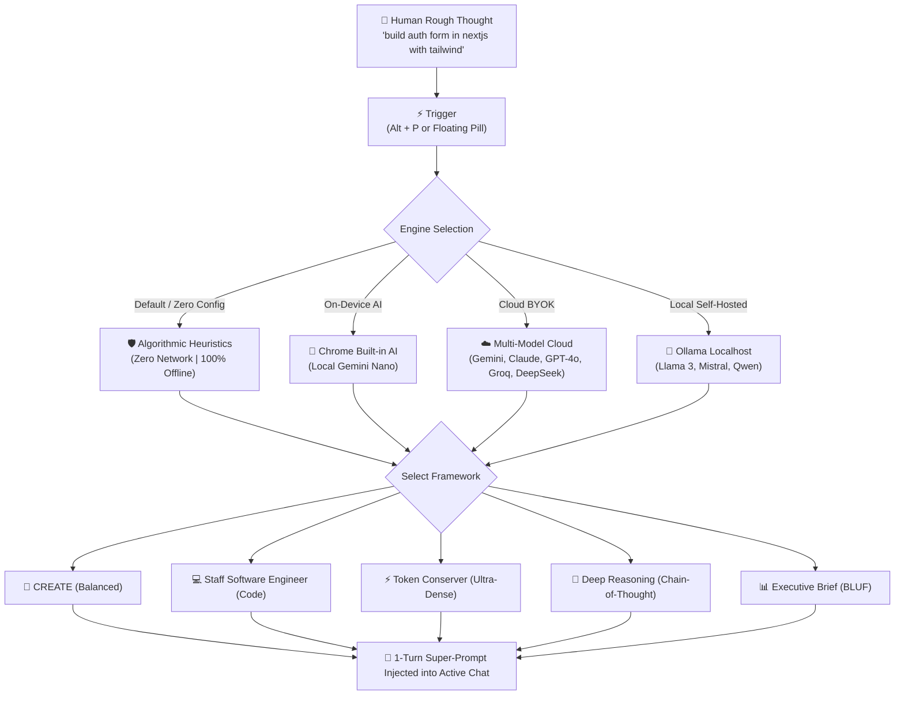

<p align="center">
  
</p>

<h1 align="center">PromptForge</h1>

<p align="center">
  <strong>The Open-Source Prompt Engineering Layer for Claude, Copilot, ChatGPT & Gemini.</strong><br>
  <em>Turn casual human thoughts into high-leverage super-prompts — directly inside your AI chatbox.</em>
</p>

<p align="center">
  <a href="LICENSE"></a>
  <a href="manifest.json"></a>
  <a href="#-privacy--zero-telemetry"></a>
  <a href="CONTRIBUTING.md"></a>
  
</p>

---

## 💥 The Problem: The "Casual Prompt" Token Tax

When people interact with state-of-the-art LLMs, **over 85% of queries are vague, informal, and context-deficient**:
> *"Write a python function to scrape a site"*

This casual input triggers what prompt researchers call **"Conversational Drift"**:
1. The AI guesses your libraries, error handling, rate limiting, and output style.
2. The initial answer is incomplete or misses your unspoken requirements.
3. You spend **3 to 5 corrective back-and-forth turns**:
   - *"No, use Playwright, not Selenium."*
   - *"Add error handling for 429 status codes."*
   - *"Don't explain anything, just output the typed code."*

### 📉 The Hidden Token Math

In modern conversational models, **the full chat transcript is re-sent with every subsequent turn**:

| Turn | What gets sent to the model | Token Cost (Est.) | Result Quality |
| :--- | :--- | :--- | :--- |
| **Turn 1 (Casual Prompt)** | "Write a python function to scrape a site" | ~25 tokens input + 600 tokens output | ⚠️ Vague / Incomplete |
| **Turn 2 (Correction #1)** | Turn 1 + "No, use Playwright..." | ~650 tokens input + 600 tokens output | ⚠️ Still missing edge cases |
| **Turn 3 (Correction #2)** | Turns 1 & 2 + "Add 429 backoff..." | ~1,300 tokens input + 600 tokens output | ⚠️ Missing type hints |
| **Turn 4 (Correction #3)** | Turns 1, 2, 3 + "Only output typed code" | ~1,950 tokens input + 500 tokens output | ✅ Finally what you wanted |
| **Total Session Consumption** | | **~6,225 tokens** & 10 minutes wasted | |

### ⚡ The PromptForge Way (1-Turn Precision)

With **PromptForge**, your rough thought is structured into an explicit prompt **before** it touches the model:

```
[Raw Thought] ──> ✨ PromptForge (Alt + P) ──> [1-Turn Precision Prompt] ──> 🎯 Perfect First-Turn Answer
```

- **Session Consumption:** ~250 tokens input + 800 tokens output = **~1,050 tokens total**.
- **Net Efficiency:** **~83% token reduction**, zero conversational drift, and instant results.

---

## 🎯 Supported Platforms

PromptForge seamlessly detects active inputs and attaches to:
- 🟣 **Claude.ai** (`div.ProseMirror`, fieldsets)
- 🟢 **ChatGPT** (chatgpt.com & chat.openai.com)
- 🔵 **Microsoft Copilot** (copilot.microsoft.com)
- 🟡 **Perplexity.ai** (perplexity.ai)
- 🔴 **Google Gemini** (gemini.google.com)

---

## 💎 Core Architecture & Frameworks

PromptForge incorporates established prompt engineering methodologies directly into your workflow:



### Curated Framework Catalog

| Framework | Best For | Output Blueprint |
| :--- | :--- | :--- |
| **🎯 CREATE (Balanced)** | General queries, learning, explanations | Character (Role) + Request + Examples + Adjustments + Type |
| **💻 Staff Engineer** | Code generation, architecture, refactoring | Strict typing + error boundaries + edge cases + zero chatter |
| **⚡ Token Conserver** | Quick queries, batch jobs, rate-limited tiers | Hyper-dense, direct syntax; strips all preamble and postscript |
| **🧠 Deep Reasoning** | System design, logic puzzles, trade-off studies | First-principles breakdown + assumption audit + counter-proposals |
| **📊 Executive Brief** | Strategic memos, business analysis, planning | BLUF (Bottom-Line Up Front) + core drivers + roadmap + risks |

---

## 🚀 Quickstart (Install in 30 Seconds)

PromptForge is built using modern Manifest V3 standards with **zero build tooling required**:

1. **Clone this repository:**
   ```bash
   git clone https://github.com/your-username/promptforge.git
   cd promptforge
   ```
2. **Open Extensions in Chrome:**
   - Navigate to `chrome://extensions/`
   - Enable **Developer mode** (toggle in the top-right corner).
3. **Load the Unpacked Extension:**
   - Click **"Load unpacked"** in the top-left.
   - Select the `promptforge` folder.
4. **Try It Out:**
   - Open [Claude.ai](https://claude.ai) or [ChatGPT](https://chatgpt.com).
   - Type any casual thought into the chat box.
   - Click the floating **"⚡ Forge"** button or press **`Alt + P`**!

---

## 🔒 Privacy & Zero Telemetry

- **100% Offline by Default:** The default Algorithmic Heuristics engine runs completely inside your browser process. No requests are sent over the network.
- **BYOK (Bring Your Own Key):** If you configure cloud providers (Gemini, Claude, OpenAI, Groq), API calls are dispatched directly from your browser to the respective official endpoints.
- **Zero Third-Party Telemetry:** No analytics scripts, no tracking pixels, no telemetry databases.

---

## 📂 Repository Layout

```
promptforge/
├── .github/
│   ├── workflows/ci.yml       # Automated Manifest & Code Integrity CI
│   ├── ISSUE_TEMPLATE/        # Structured Bug Report & Feature Request templates
│   └── PULL_REQUEST_TEMPLATE.md
├── manifest.json              # Chrome Manifest V3 specification
├── icons/                     # Multi-resolution SVG-derived PNG icons
├── background/
│   └── service-worker.js      # Background routing, context menus & command listener
├── content/
│   ├── content.js             # Platform DOM observers, HUD modal & synthetic injector
│   └── content.css            # Dark-mode glassmorphic HUD styling
├── popup/
│   ├── popup.html             # Toolbar scratchpad & live token metrics dashboard
│   ├── popup.js
│   └── popup.css
├── options/
│   ├── options.html           # Full settings pane for Model & API configuration
│   ├── options.js
│   └── options.css
└── src/
    ├── ai/
    │   ├── engine.js          # Multi-provider dispatcher (Gemini, Anthropic, OpenAI, Groq, Ollama)
    │   └── prompts.js         # Meta-prompt definitions & offline heuristic engines
    ├── templates/
    │   └── catalog.js         # Framework definitions (CREATE, BLUF, Staff Eng)
    └── utils/
        └── storage.js         # Type-safe chrome.storage wrapper & metric math
```

---

## 🗺️ Roadmap

- [x] Initial release with Manifest V3 support
- [x] Support for Claude, Copilot, ChatGPT, Perplexity, and Gemini
- [x] Zero-setup Offline Algorithmic Heuristics
- [x] Multi-model cloud dispatch (Gemini 2.0 / 1.5, Claude 3.5, GPT-4o, Groq, DeepSeek, Ollama)
- [x] In-chat HUD with quick framework switching
- [ ] Custom user-authored prompt framework templates
- [ ] Multi-turn prompt chaining for complex multi-agent workflows
- [ ] Firefox Add-on and Safari Extension ports

---

## 🤝 Contributing

Contributions are what make the open-source community an incredible space to innovate!

Please review [CONTRIBUTING.md](CONTRIBUTING.md) for local development setup, code conventions, and pull request guidelines.

---

## 📄 License

PromptForge is licensed under the **Apache License, Version 2.0**. See the [LICENSE](LICENSE) file for complete details.
